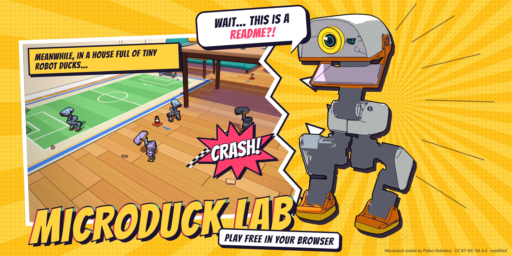
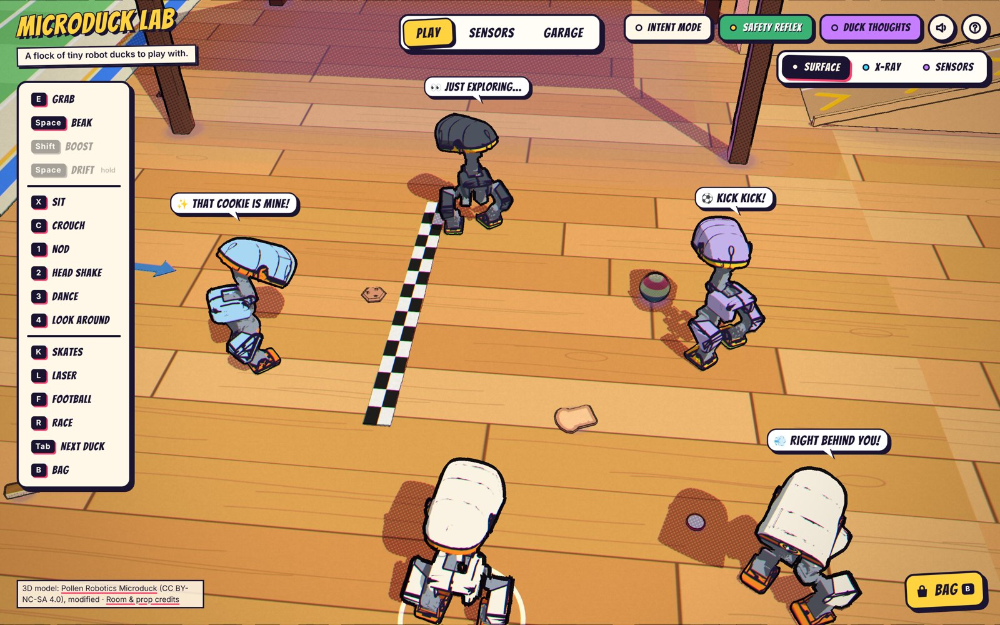
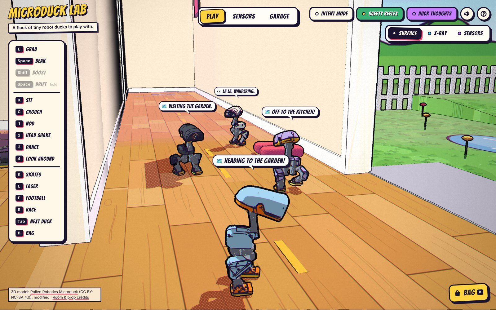

<p align="center"></p>

<h1 align="center">Microduck Lab</h1>

<p align="center">
  A flock of tiny robot ducks loose in a comic-book house, playable in your browser.<br/>
  <a href="https://r1chi33333.github.io/microduck-lab-preview/"><b>▶ Play it now</b></a> · no install, no sign-up
</p>

<p align="center">
  
  
  
</p>

---

## What is it

Pick your duck's colours, then waddle around a house full of other robot ducks who all have their own plans. Grab toys with your beak, strap on roller skates and drift across the kitchen tiles, play football, race the flock around the house, or point a laser and watch everyone lose their minds. Speech bubbles show what every duck is thinking.

| | |
|---|---|
|  |  |

## Things to do

- **Build your duck**: colourways per part, and a voice.
- **Walk, grab, emote**: sit, crouch, nod, head shake, dance, look around, and carry toys in your beak.
- **Roller skates**: boost, hold to drift, smoke, sparks and skid marks.
- **Laser pointer**: the whole flock chases the dot.
- **Football and racing**: a sock-ball match in the living room, and a lap race through every room (or a solo drag strip down the hallway).
- **The bag**: drag in more ducks, skates and toys (cookies, toy cars, chess pieces, rubber ducks…).
- **A whole house**: living room, hallway, kitchen, kids' bedroom (the bed is bouncy) and a garden with a puddle.
- **Duck thoughts**: comic speech bubbles show what each AI duck is up to (toggle with `T`).

## Controls

| Key | Move | Key | Move |
|---|---|---|---|
| `W A S D` | walk / skate | `K` | skates on/off |
| `E` | grab / drop | `Shift` | boost (on skates) |
| `Space` | beak (walking) / drift (skating, hold) | `L` | laser pointer |
| `X` / `C` | sit / crouch | `F` | football |
| `1`–`4` | nod, head shake, dance, look around | `R` | race |
| `Tab` | switch to the next duck | `B` | open the bag |
| `T` | duck thoughts on/off | `?` | all controls |

On a phone there's a joystick and touch buttons.

## How it's made

Plain JavaScript modules, no build step.

- **three.js** rendering with a custom comic look: banded toon shading, hard ink outlines from a depth/normal post pass, and pop-art stickers (`ZOOM`, `SNAP!`, `BONK!`).
- **Rapier** physics for the ducks, toys and the ball.
- **Procedural walking**: a two-link IK gait drives each leg, so ducks step, sit, skate and wobble without baked animations.
- **Flock AI**: each duck runs a small brain (wander, roam to another room, fetch a toy, chase the ball or the laser, follow you, race), plus boids-style spacing.
- **Procedural sound**: footsteps, wheels and chirps are synthesised with WebAudio.

## Run it locally

The game loads three.js and Rapier from a CDN, so any static file server works:

```bash
git clone https://github.com/R1chi33333/microduck-lab
cd microduck-lab
python3 -m http.server 8000
# open http://localhost:8000
```

## Credits and licence

- The **Microduck robot** is by [Pollen Robotics](https://github.com/pollen-robotics/microduck_rl), licensed [CC BY-NC-SA 4.0](https://creativecommons.org/licenses/by-nc-sa/4.0/). It's used here with modifications (an articulated rig with an added jaw joint and a comic recolour), **for non-commercial use only**, and the rig file `microduck_rig.glb.txt` stays under that licence.
- Other third-party props, the Bangers font and the libraries are listed with their licences in [CREDITS.md](CREDITS.md).
- The **game code** in this repository is released under the [MIT License](LICENSE). The MIT licence does not cover the third-party assets above.
